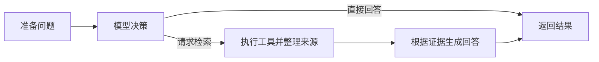

# ResearchAgent

ResearchAgent 是一个用 FastAPI 提供接口的论文问答项目。它从本地 PDF 提取文本，用 FastEmbed 检索相关片段，再通过 DeepSeek 生成回答。三条问答链共享检索代码，方便对比固定 RAG、模型工具调用和 LangGraph 编排。

| 方式 | 接口 | 流程 |
| --- | --- | --- |
| 固定 RAG | `POST /rag/ask` | 每次都检索论文片段，再调用模型回答 |
| V1 Agent | `POST /agent/ask` | 模型决定是否调用 `search_paper`，由 Python 代码执行工具并组织后续回答 |
| V2 LangGraph | `POST /graph/ask` | 状态图管理问题、工具调用、来源和回答，按模型决策选择分支 |



V1 和 V2 都支持一次决策发出多个检索调用。V2 按页码和片段 ID 去重，保留最高分并按分数降序返回。当前实现以单轮工具决策为主。

## 本地运行

使用 Python 3.12 或更高版本，已在 Python 3.13.7 上验证。以下命令在 Windows PowerShell 的项目根目录运行。

```powershell
python -m venv .venv
.\.venv\Scripts\Activate.ps1
python -m pip install -r requirements.txt
python -m uvicorn api:app --reload
```

打开 [Swagger 接口文档](http://127.0.0.1:8000/docs) 查看接口。可以先调用 `GET /` 检查服务是否启动。启动服务和运行测试无需配置真实密钥或准备 PDF。

体验问答时，把一份可提取文本的 PDF 放在 `data/sample.pdf`，在启动服务前设置环境变量。

```powershell
$env:DEEPSEEK_API_KEY="你的 API Key"
```

三条问答链在首次调用时都会准备检索资源，FastEmbed 此时可能下载 `BAAI/bge-small-en-v1.5`。更换 PDF 后重启服务，以重新构建缓存。密钥和 PDF 应留在本地。

| 配置 | 默认值 | 作用 |
| --- | --- | --- |
| `DEEPSEEK_API_KEY` | 无 | 三条问答链的模型服务凭据 |
| `DEEPSEEK_MODEL` | `deepseek-flash` | V1 和 V2 的模型 |
| `DEEPSEEK_BASE_URL` | `https://api.deepseek.com` | V1 和 V2 的模型地址 |
| `DEEPSEEK_MAX_TOKENS` | `700` | V1 和 V2 的单次回答 token 上限 |
| `LOG_LEVEL` | `INFO` | API 日志级别 |

固定 RAG 使用代码中的模型和地址，回答上限为 800 token。

## 请求示例

在 Swagger 里选择任一问答接口，提交相同的问题来对比三条链的行为。

```json
{
  "question": "论文中如何评估方法的性能？请给出依据。"
}
```

三个接口都返回 `answer` 和 `sources`，固定 RAG 额外返回 `question`。每条来源包含 `page`、`chunk_id`、`score` 和 `preview`。Agent 选择直接回答时，`sources` 为空。来源是检索到的候选证据，需要结合原文核对结论。

## 测试

```powershell
python -m pytest -q
```

- 固定 RAG 测试在临时目录生成示例 PDF，验证解析、检索、证据拼装和接口响应。嵌入模型和 DeepSeek SDK 使用模拟对象。
- V1 测试覆盖直接回答和工具分支，检查工具调用 ID 与证据如何传回模型。
- V2 测试运行实际 LangGraph，检查条件路由、多工具证据、来源去重和排序。
- API 测试覆盖请求与响应校验、模型调用失败时的 HTTP 502，以及 V2 执行日志。模型响应与异常均由测试模拟，运行测试不会产生模型调用费用。

## 项目结构

```text
ResearchAgent/
├── api.py                # FastAPI 路由和响应校验
├── config.py             # Agent 模型及日志配置
├── agent_runner.py       # V1 流程及共用工具调用逻辑
├── agent_tools.py        # 论文检索工具定义与执行
├── graph_agent.py        # V2 状态、节点与路由
├── pdf_parser.py         # PDF 文本提取与分块
├── rag_retrieval.py      # 向量化、相似度与来源
├── rag_answer.py         # 固定 RAG 的模型调用
├── data/                # 本地放置 sample.pdf
├── tests/
├── pytest.ini
├── requirements.txt
├── .gitignore
└── README.md
```

项目一次检索一份本地 PDF。问答状态随请求创建，来源页码从 PDF 的第一页起计数。
